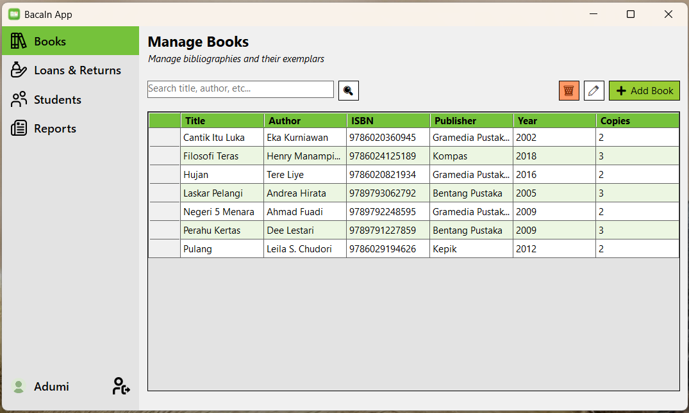

# BacaIn App



**BacaIn** is a school library management desktop application built with **.NET 10 Windows Forms**, **Entity Framework Core**, and **PostgreSQL**.

## Features

- **Authentication & Role Routing**: PBKDF2-SHA256 password verification with separate flows for `Admin` and `Student` accounts.
- **Manage Books**: Full CRUD for bibliographies and their physical exemplars (copies), live search, soft-deletes with active-loan protection, cover file picker, and automatic **ISBN Lookup** via Open Library and Google Books.
- **Manage Loans & Returns**: Student picker, 14-day loan creation with overdue-loan and exemplar-availability checks, and book returns with automatic late fine calculation.
- **Manage Students**: Student account CRUD with active-loan delete protection and quick navigation to a student's loans.
- **View Reports**: Filterable **Loans & Returns**, **Inventory**, **Reservations**, and **Check-ins** reports with summary cards and print preview.

## Tech Stack

- **UI**: Windows Forms (`.NET 10.0-windows`)
- **ORM**: Entity Framework Core 10 + `EFCore.NamingConventions` (snake_case)
- **Database**: PostgreSQL (`Npgsql.EntityFrameworkCore.PostgreSQL`)

---

## Local Database Setup

### Prerequisites

- [PostgreSQL](https://www.postgresql.org/download/) running locally (default port `5432`)
- Target database created (default name: `bacain`)

### 1. Configure `appsettings.json`

The published `BacaIn.exe` reads its database connection from `appsettings.json` in the **same folder as `BacaIn.exe`** (or from the `BACAIN_CONNECTION_STRING` environment variable).

Edit `appsettings.json` next to `BacaIn.exe` (or `BacaIn/appsettings.json` when running from source):

```json
{
  "ConnectionStrings": {
    "BacaIn": "Host=localhost;Port=5432;Database=bacain;Username=postgres;Password=your_password"
  }
}
```

### 2. Apply Migrations & Seed Sample Data

Run the published executable with `--seed` to automatically apply EF Core migrations and populate sample users, books, exemplars, loans, reservations, and check-ins:

```powershell
.\BacaIn.exe --seed
```

*(If running from source instead of the published executable, use `dotnet run --project BacaIn -- --seed`.)*

### Default Seeded Accounts

| Role | Username | Password |
| :--- | :--- | :--- |
| Admin | `admin` | `admin123` |
| Student | `budi` | `password123` |

*(Additional seeded students: `siti`, `andi`, `dewi`, `rizky`, `putri` — all with password `password123`.)*

### 3. Run the Application

Launch `BacaIn.exe` directly, or run from source during development:

```powershell
dotnet run --project BacaIn
```

---

## Project Structure

```text
BacaIn/
├── Controls/
│   ├── Components/   # Reusable UI controls (SelectUser, CircularPictureBox)
│   ├── Dialogs/      # Modal forms (BookDialog, CreateLoanDialog, StudentDialog)
│   └── Pages/        # Main admin views (ManageBooks, ManageLoansReturns, ManageStudents, ViewReports)
├── Data/             # AppDbContext, AppDbContextFactory, DatabaseSeeder, Migrations
├── Models/           # EF Core entities (Bibliography, Exemplar, Loan, Reservation, CheckIn, User)
├── Resources/        # Icons, avatars, logo.png, app.ico
├── AdminForm.cs
├── LoginForm.cs
└── StudentForm.cs
docs/
├── plan.drawio       # System diagrams & UI wireframes
└── screenshot.png
```

---

## Contributing

1. **Fork & Branch**: Create a feature or fix branch from `master`:
   ```powershell
   git checkout -b feat/your-feature
   ```
2. **Follow WinForms & Code Conventions**:
   - Keep `*.Designer.cs` strictly for control layout (`Location`, `Size`, `Anchor`, `AutoScaleDimensions`) and named event subscriptions inside `InitializeComponent()`.
   - Put event handler implementations and business logic in the main `*.cs` partial class.
   - Keep `namespace BacaIn.Controls` for controls inside `BacaIn/Controls/`.
   - Use `DateTime.UtcNow` when persisting timestamps to PostgreSQL.
3. **Verify Before Opening a PR**:
   ```powershell
   dotnet build BacaIn\BacaIn.csproj --nologo
   ```
4. **Commit Style**: Use lowercase [Conventional Commits](https://www.conventionalcommits.org/) (e.g., `feat(scope): short summary`, `fix(ui): ...`).
